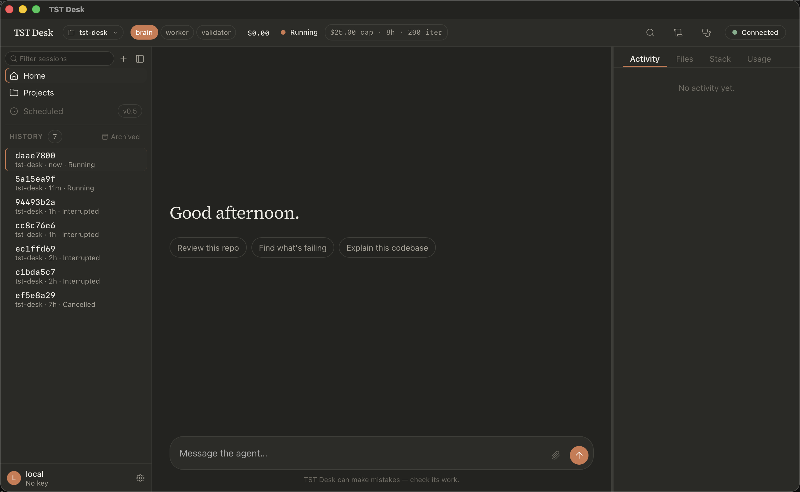

# TST Desk

**An open-source, bring-your-own-model desktop agent workspace.**

Point it at a folder, say what you want, and watch it work. It reads files, runs commands, and
asks before it does anything consequential. It looks and feels like Claude Desktop, but it runs
on the models you choose, billed to your own key.

- **Open source, no account.** Apache-2.0. Nothing to sign up for, no hosted backend, no
  subscription. You pay your model provider per token, and nobody else.
- **Any OpenAI-compatible model.** Paste a server URL, pick a model, start working. A live
  meter in the title bar shows what each turn and session costs, and a spend cap pauses the
  session when it is reached.
- **Works offline with a local model.** Pointed at a model server on your own computer, it
  needs no API key and no network.
- **Asks before it acts.** Every tool call goes through a classifier. Reads and edits inside
  your folder run on their own. Other shell commands, anything outside the folder, and
  anything it cannot classify wait for your approval.
- **Keys stay in your OS keychain.** Keychain on macOS, Secret Service on Linux, Credential
  Manager on Windows. Never in a config file or a log.
- **A native app for macOS, Linux and Windows.** Built on Tauri: a Rust shell on the system
  webview, with the agent daemon bundled in. No Electron. An Android app pairs with a QR code
  and follows your sessions from your phone.

**[Download the latest release](https://github.com/ThatSimpleTech/TST-Desk/releases/latest)**
· [Install steps](#install) · [Quickstart](#quickstart) · [How models work](docs/models.md)



## Works with

TST Desk talks to any server that speaks the OpenAI chat API. No model ships with it; the
first run walks you through adding one.

| What | Examples | Key |
|---|---|---|
| A model server on your computer | Ollama, vLLM, LM Studio, llama.cpp's server | None. No key is asked for, and none is sent to `127.0.0.1` or `localhost`. |
| A hosted model API | A provider's OpenAI-compatible `/v1` endpoint | Your key, stored in the OS keychain and sent only to that URL |
| A gateway in front of many models | A router or proxy that speaks the OpenAI chat API | Your key for the gateway |
| A server you run on another machine | Your own vLLM or llama.cpp behind a key | A named key for that server |
| Anything else | Any endpoint that speaks the OpenAI chat API | Whatever that endpoint needs |

You can also mix them: a team gives planning, doing and checking their own models, for
example a hosted model that plans and a local one that does the work. See
[docs/models.md](docs/models.md).

---

## Install

Get the newest build from
[the latest release](https://github.com/ThatSimpleTech/TST-Desk/releases/latest). Every release
has these files:

| Platform | File |
|---|---|
| macOS, Apple silicon | `.dmg` (`aarch64`) |
| macOS, Intel | `.dmg` (`x64`) |
| Linux, x86_64 | `.AppImage` or `.deb` (`amd64`) |
| Linux, ARM64 | `.AppImage` (`aarch64`) or `.deb` (`arm64`) |
| Windows, x64 | `.msi` |
| Android phone (optional) | `.apk` |

`SHA256SUMS.txt` on the same release lists a checksum for each desktop file.

1. Download the file for your platform.
2. Check it against `SHA256SUMS.txt`.
3. Install it:
   - **macOS** — open the `.dmg` and drag **TST Desk** to Applications.
   - **Linux** — `chmod +x` the AppImage and run it, or install the `.deb` with
     `sudo apt install ./<file>.deb`. To save API keys, install `libsecret-tools` and have
     your desktop's keyring running ([docs/linux.md](docs/linux.md)).
   - **Windows** — run the `.msi`.
4. The first launch shows a warning on macOS and Windows, because release builds are not
   notarized (macOS) or code-signed (Windows).
   [Installing an unsigned build](#installing-an-unsigned-build) below has the one-time
   click-through.

**The phone app** follows sessions on your computer from an Android phone. It is a viewer for
your own computer, not a cloud service: both devices need Tailscale. Install the `.apk`, then
pair it from **Settings → Phones and devices → Pair a phone** on the computer by scanning the QR code.
[android/README.md](android/README.md) has the details.

The app also runs from source — see [Development](#development).

## Quickstart

Five minutes, launch to first result. No model ships, so the first-run wizard is: welcome →
add a model → workspace → done. [How models work](docs/models.md) walks through every step.

1. **Download it, install it, open it.** [Install](#install) above has the per-platform steps;
   clearing the unsigned-build warning on first launch is a one-time click.
2. **Add a model.** Paste the API URL of any server that speaks the OpenAI chat API — a hosted
   provider, or a model server on this computer (llama.cpp, vLLM, Ollama, LM Studio). For a
   hosted one, paste its API key; it goes into your OS keychain, not a file, and is sent only to
   that URL. For a server on this computer no key is asked for and none is sent. TST Desk lists
   the server's models, you pick one and give it a label and a one-line description, and it
   sends one short test message so you know it works.
3. **Switch models from the picker.** The chip under the message box opens the model picker:
   your models with their descriptions, an Effort level, and **Add a model** for the next one.
   A model on the picker is a `presets:` entry in your `config.yaml`; [docs/models.md](docs/models.md)
   shows how to write one by hand, and how to build a team that gives planning, doing and
   checking their own models.
4. **Pick a workspace.** A native folder picker. The folder is the unit of work — TST Desk
   scaffolds a `.tst/` directory in it with a commented default config, resolves any `AGENTS.md`
   or `CLAUDE.md` it finds, and shows you the resolved instruction stack.
5. **Type a request.** You get streamed output in the chat pane, an activity timeline on the
   right, and an approval card whenever it wants to do something that needs your say-so. Approve
   it, and you have your first result.

Nothing in those five steps creates an account anywhere.

## Grok Build engine

TST Desk can wrap the installed [Grok Build CLI](https://docs.x.ai/build/overview)
instead of its native three-tier loop. Settings → Engine → Grok Build. New sessions then
spawn `grok agent stdio` over ACP; the window, approvals, coworker mode, and timeline stay
TST Desk's. The CLI is not replaced: `grok`, `grok -p`, and `grok agent stdio` keep working
on their own, sessions still live under `~/.grok`, and `grok --resume` still opens the TUI.
Grok credentials stay in `~/.grok/auth.json` — never in TST Desk's config.

## What it costs

You are billed by your provider for the tokens you use. Nothing is billed by us, because there
is nobody to bill you — see [The promises](#the-promises).

Every turn routes three roles, called tiers: a **brain** for planning turns, a **worker** for
token-heavy edits, and a **validator** for review. One model can fill all three; a team lets
cheap tiers do the volume while the expensive tier only plans. No model ships, so no price
ships either: each model entry in your `config.yaml` carries the dollars-per-million-token
prices the meter uses. The "Add a model" walkthrough fills them in when the server reports
them and leaves them at `0.0` otherwise; edit them there.

Model slugs are deliberately not restated here. The landscape moves weekly, so your
`config.yaml` is the one place they live — change them there without waiting for a release.

**A worked turn.** Token counts and prices below are illustrative, but the arithmetic is the
shipped one — this is [`compute_call_details`](core/tstd/cost.py) run on a brain priced at
$2.80 input, $14.00 output and $0.30 cache read per million tokens. A turn sending 20,000
prompt tokens, of which the provider reports 15,000 served from cache, and generating 1,500
tokens:

```
  5,000 uncached prompt  × $2.80/M  =  $0.0140
 15,000 cached prompt    × $0.30/M  =  $0.0045
  1,500 completion       × $14.00/M =  $0.0210
                                       -------
                                       $0.0395
```

Cache-read tokens are always priced at the cache rate, never the input rate — and only when the
provider actually reports them. A provider that says nothing about cache reuse is billed as if
there was none, so the meter never quietly understates what you owe.

**Per session.** The spec estimates the three-tier stack at roughly **$0.36 per working
session** (`docs/tst-desk-spec.md` §1). Treat that as an estimate, not a measurement: it is a
design-time figure, and this build has not published one of its own. What the build does give
you is the real one — a live meter in the title bar showing spend per turn, per session and per
day, broken down by tier, plus a spend cap that pauses the session when it is hit.

**Per session, on a model on this computer.** Zero. Its prices are `0.0` unless you set
them, so the meter reads `$0.00` and means it.

## The promises

These are not marketing lines. They are architectural constraints, written down as prime
directives in [`AGENTS.md`](AGENTS.md) §2 and enforced in code.

- **No account.** There is nothing to sign up for. The only credential in the system is your own
  provider API key, and for a model on this computer there is not even that:
  [`config.py`](core/tstd/config.py)'s `requires_api_key()` returns false when every tier points
  at loopback, and the provider client is then built with `api_key=None` and sends no
  `Authorization` header at all.
- **No server.** The daemon binds `127.0.0.1` by default.
  [`ws.py`](core/tstd/ws.py)'s `validate_interface()` refuses every other interface unless
  `remote.bind` names a Tailscale address (never `0.0.0.0`). `start()` takes no `host`
  parameter. `core/tests/test_security_suite.py` asserts both. The webview holds its end of
  the same boundary: every inbound frame is validated down to its event type
  ([`client.ts`](ui/src/lib/client.ts) drops and counts anything outside the known union),
  while payload shapes are trusted to the token-authenticated daemon peer — the only writer
  of that socket, and the other half of this repo.
- **No subscription.** You pay your model provider per token and nobody else. There is no
  billing code in this repository because there is nothing to bill.
- **No telemetry.** No analytics, no phone-home, no crash reporting. The only outbound HTTP the
  daemon makes is to the `base_url` you configured: there is exactly one chat client
  ([`provider.py`](core/tstd/provider.py)), and its endpoint comes from config, never from a
  literal in the source. Model discovery refuses any non-loopback endpoint *before* it sends
  ([`discovery.py`](core/tstd/discovery.py)).
  [`core/tests/test_outbound_hosts.py`](core/tests/test_outbound_hosts.py) enumerates every
  destination the process can open — source literals, the live sending paths, and import-time
  sockets — and fails if a host appears that configuration did not name.
- **Your key never touches disk.** It lives in the OS keychain — Keychain, Secret Service, or
  Credential Manager ([`keychain.py`](core/tstd/keychain.py)). Every log and audit path runs
  through one shared redactor ([`logging.py`](core/tstd/logging.py)), and
  `core/tests/test_credential_hygiene.py` drives a real daemon with a canary key and asserts it
  appears in no wire payload, no log record, and no byte of any file under the data directory —
  and in no audit row, where the credential flow produced a database to scan.
- **Your conversation sits on disk unencrypted.** Each session writes its full model
  conversation — your messages, the assistant's replies, and every tool call with its arguments
  and result — as plaintext JSON to
  `<user data dir>/sessions/<session id>/conversation.json`
  ([`session_persist.py`](core/tstd/session_persist.py); e.g.
  `~/Library/Application Support/com.thatsimpletech.tstdesk/sessions/` on macOS), written
  owner-only and without passing through the credential redactor that guards logs and audit
  rows. That is deliberate, not an oversight: reviving a session after a crash needs the actual
  chat, and local-first means your OS user account is the boundary. There is no knob that turns
  the file off or moves it on its own — start the daemon with a different `--data-dir` to
  relocate it with the rest of the data directory, or delete the session to delete its copy.
- **Files the agent sends are kept with the session.** `send_file` keeps a copy of each file
  under `<user data dir>/sessions/<session id>/artifacts/`, owner-only, until you delete the
  session, so a card opens the bytes that were sent even after a rebuild overwrites the
  original. The copy is your file verbatim; it is not redacted, and it never goes to a log or
  the audit database. Limits: 512 MiB per file and 4 GiB per session
  (`session.send_file_max_bytes`, `session.send_file_session_max_bytes`).
- **The agent cannot rewrite its own rules.** `AGENTS.md`, `CLAUDE.md` and `.tst/rules/**` are
  refused by the filesystem tool itself ([`tools/boundary.py`](core/tstd/tools/boundary.py)),
  ahead of the workspace check and ahead of any approval — so no `writable_paths` grant can open
  them.

## How it compares

Against Claude Desktop, Cowork, and hosted agent workspaces generally. These are good products
built by large teams, and this table is only useful if it says so.

| | TST Desk | Claude Desktop / Cowork / hosted workspaces |
|---|---|---|
| **Setup** | Get an API key, paste it, pick a folder | Sign in and go. Genuinely less work |
| **Polish** | Early 0.x releases, in active development. Builds are not notarized or code-signed, and update from GitHub releases after a checksum check | Years of QA, signed, notarized, auto-updating |
| **Support** | GitHub issues and whoever shows up | A company, a support channel, an SLA |
| **Infrastructure** | Yours to run; local models need local hardware | Managed. Nothing to provision, nothing to keep warm |
| **Model quality out of the box** | Whatever you pick and pay for | Frontier models in a harness tuned for them |
| **Mobile / sync** | An Android app that attaches to your own computer over Tailscale. No cloud sync | Usually both |
| **Pricing** | Per token, metered live — no floor, and a spend cap that pauses you | Flat subscription — predictable, and cheaper if you are a heavy user |
| **Model choice** | Any OpenAI-compatible endpoint; three tiers you pick, with routing pinnable mid-session | The vendor's models |
| **Whose key** | Yours. You see the bill and the meter | The vendor's, folded into the subscription |
| **Offline** | Runs against a local model server — no key asked for, none sent | No |
| **Audit trail** | Append-only SQLite on your disk — INSERT-only by construction; model calls export to CSV or JSONL | The vendor's logs, on the vendor's terms |
| **Steering** | `AGENTS.md` hierarchy you own, with an inspector showing the resolved stack and its token cost | Project instructions, less visible |
| **Source** | Apache-2.0. Fork it, audit it, change the model table | Closed |
| **Account** | None | Required |

Where they genuinely win: nothing to configure, nothing to keep running, and a product that has
been shipping long enough to have had its rough edges filed off. If you want an agent workspace
that just works today, buy one of theirs. TST Desk is for people who want to own the key, the
model choice, the audit trail, and the code.

## Status

TST Desk is in active development, with 0.x releases. Every release is on
[the releases page](https://github.com/ThatSimpleTech/TST-Desk/releases), and the newest is
always at [releases/latest](https://github.com/ThatSimpleTech/TST-Desk/releases/latest).
Pushing a `tstdesk-v*` tag runs [`release.yml`](.github/workflows/release.yml), which builds
the five desktop platforms with [`package.yml`](.github/workflows/package.yml) and publishes
them with `SHA256SUMS.txt`. The Android `.apk` is built by hand and added to the release.
GitHub Actions is budget-capped at **$20/month**. Default CI is three
Linux jobs; five-platform Package runs only on demand or on a new
`tstdesk-v*` tag — see [`docs/ci-actions-blocked.md`](docs/ci-actions-blocked.md).
App releases tag as `tstdesk-v*` (`TD-4812`) so a package tag like
`v0.2.0` (the `tst-cu-mcp` server, not the app) cannot fire the app
workflow. The app also runs from source.
Every bundle is scanned for the maintainer's private names and hosts
before it ships (`core/scripts/release_scan.py`, TD-5163; the list is a
repository secret). The hand-built APK gets the same check before upload:
`cd core && uv run python scripts/release_scan.py --require ../android/app/build/outputs/apk/release/app-release.apk`.

What works: streaming chat, the three-tier router, the steering assembler and instruction
inspector, filesystem and shell tools behind a decision classifier and approval cards, path
boundaries and spend/time/iteration caps, the live cost meter and usage export, the
append-only audit log, agent memory that rides the brain prompt and accepts distilled
updates, sessions that revive from disk after a restart or a closed window (close vs quit
below), headless runs via `tst run`, computer-use — a screenshot and clicks through the
same classifier, behind a kill switch — on macOS, Windows, and Linux X11 via `tst-cu-mcp` (browser
path on any OS), the agent sends files to the chat (`send_file`) as cards you can open, save,
or download to the paired phone, where an APK opens the installer, steering edits the agent
proposes (`propose_steering_edit`) as a diff that only your Accept writes, a task list the
agent keeps (`task_list`) in the Plan pane and above the composer that outlives compaction,
questions the agent asks you (`ask_user`) as buttons to tap on the window or the phone,
a done-check (`stop_check` in `.tst/config.yaml`, or `/goal`) that sends the agent back to work
when it stops before a command passes or a statement holds, remote attach over
Tailscale (never `0.0.0.0`) with Slack/ntfy notify
and the scheduler rail, local vLLM workers (`computer_use.local_worker_preset`) and UI-TARS grounding for local pixel loops,
a validating `CHARTER.md` schema and the project-home charter editor, the
autonomy engine (unattended runner, circuit breakers, hard-required container),
slash commands, `SKILL.md`, plan lock, MCP loading (with `tool_search` loading MCP tools
on demand once their schemas would crowd the window),
Design mode on browser and desktop frames,
plus the session rail, settings, diagnostics, and keyless local-model support.

What is not built yet, and is not claimed anywhere above: Wayland desktop
capture.
Those are later stories — see [`docs/tst-desk-spec.md`](docs/tst-desk-spec.md) §9 for
the phasing.

### Close vs Quit

Closing the window is not quitting the app. The daemon keeps working after the window is gone.

- **macOS** — the red traffic-light **closes** (hides) the window; the Dock icon stays.
  Click the Dock icon to show the window again. **⌘Q** or **Quit TST Desk** from the menu
  or Dock is Quit: the daemon shuts down and is reaped.
- **Windows** — the title-bar **X** or Alt+F4 hides the window. `tstd` keeps running.
  Opening the app again shows the window, or a new host process attaches to the live
  daemon instead of starting a second one. **Quit TST Desk** (File menu or ⌘K palette)
  shuts the daemon down.
- **Linux** — the window close button hides the window the same way. **Quit TST Desk**
  from the app menu or the command palette is what stops `tstd`.

The first time you close the window: that hides TST Desk. **Quit TST Desk** is what stops it.

OS notifications for an approval or a finished turn still fire while the window is hidden.
While hidden, a running session or a parked approval badges the Dock (macOS) or the
taskbar tooltip (Windows / Linux). A tray icon shows the running-session count; **Quit TST Desk** lives in the tray menu too. Clicking the app icon shows the window and focuses
the approval if one is waiting.

See [`docs/tst-desk-backlog.md`](docs/tst-desk-backlog.md) for the current milestone and
[`docs/tst-desk-spec.md`](docs/tst-desk-spec.md) for the full architecture spec. How the pieces
fit together — the daemon/shell split, the wire protocol, the extension points, and how to add a
tool — is in [`docs/architecture.md`](docs/architecture.md). Every configuration key is
documented in [`docs/configuration.md`](docs/configuration.md), and writing `AGENTS.md` and
path-scoped rules is covered in [`docs/steering.md`](docs/steering.md). Where Windows behaves
differently — path forms, 8.3 short names, file permissions, killing a command — is in
[`docs/windows.md`](docs/windows.md), and where Linux does is in [`docs/linux.md`](docs/linux.md).

## Development

### Prerequisites

- Python 3.11+
- [uv](https://docs.astral.sh/uv/) (Python package manager)
- Rust 1.89+ (for the Tauri host; the locked dependencies need it)
- Node.js 24+ (for the frontend)
- Linux only — WebKit/GTK headers for the Tauri host, plus `secret-tool` for the
  keychain:

  ```bash
  sudo apt-get install -y \
    libwebkit2gtk-4.1-dev libayatana-appindicator3-dev librsvg2-dev \
    patchelf pkgconf libsecret-tools
  ```

  On Ubuntu 26.04, install `libayatana-appindicator3-dev` (not
  `libappindicator3-dev`): the older name removes `network-manager-applet`.

### Setup

```bash
# Python core
cd core
uv sync

# Frontend
cd ../ui
npm install
```

### Running it

```bash
# From ui/ — builds the Rust host, starts the daemon as a sidecar, opens the window
npm run tauri:dev

# Optional: one headless turn against the same daemon (starts tstd if needed)
cd core && uv run tst run --workspace /path/to/folder --message "say hi"

# Scripts: continue the folder's most recent session, message on stdin, one JSON result
echo "and now the tests" | uv run tst run --workspace /path/to/folder --continue --output json
# (--session <id> picks a session; --output ndjson streams its events;
#  exit 0 success, 1 error, 3 a tool call was refused, 4 approval needed)

# Unattended: rules for this run only, and refuse (not wait on) anything that asks
uv run tst run --workspace /path/to/folder --allow "shell:npm test*" --deny fs_write \
  --on-ask deny-and-continue --message "run the tests and report"

# Follow a session already running on that daemon (Ctrl+C detaches)
uv run tst attach <session_id>
```

### Tests

```bash
cd core && uv run pytest        # Python core
cd ui && npm test               # frontend
```

### Pre-commit hooks

This repository uses [pre-commit](https://pre-commit.com) to run linting, formatting, and
secret detection on every commit.

```bash
# Install hooks (one-time, from the core/ directory)
cd core
uv run pre-commit install
```

The hooks will then run automatically on `git commit`:
- **ruff check** — lint Python files
- **ruff format** — format Python files
- **Secret detection** — blocks commits containing API keys, tokens, passwords, and other
  credential-like patterns

To bypass the hooks (e.g. for a false positive):
```bash
git commit --no-verify
```

## Installing an unsigned build

Release builds are not code-signed or notarized with a publisher certificate: the release
workflow has no signing step yet. `DECISIONS.md` (2026-08-14) and
[`docs/signing.md`](docs/signing.md) record why, what signing would cost, and how CI would
wire it. Each OS warns on first launch. That is expected, not a defect.

- **macOS** — Gatekeeper blocks the app the first time you open it. On macOS 15 or later,
  open **System Settings → Privacy & Security**, find the message about TST Desk, and click
  **Open Anyway**. On earlier versions, right-click the app, choose **Open**, then confirm.
  If neither works, clear the download quarantine:
  `xattr -d com.apple.quarantine "/Applications/TST Desk.app"`.
- **Windows** — SmartScreen shows "Windows protected your PC". Click
  **More info → Run anyway**.
- **Linux** — no signing warning. For the AppImage, `chmod +x` and run it; install the
  `.deb` with `sudo apt install ./<file>.deb`.
- **Android** — the `.apk` is a sideload build, not a store app. Android asks you to allow
  installs from the app you open it with.

## Updates

A packaged app checks [GitHub releases](https://github.com/ThatSimpleTech/TST-Desk/releases)
for a newer `tstdesk-v*` tag when it opens, and every four hours after that.
**TST Desk → Check for Updates…** (File menu on Windows and Linux) and
**Check for updates** in the command palette do the same thing on demand.

When a newer release exists, the app downloads the installer for this
machine and installs it only if the file matches `SHA256SUMS.txt` on that
release. macOS and AppImage builds replace themselves when you choose
**Restart to update**. Windows runs the MSI. A `.deb` opens in the system
installer. The check sends no account and no identifier. Turn it off under
Settings → About. A build you are running from a source checkout reports
the release and does not replace itself.

## License

Apache-2.0. See [`LICENSE`](LICENSE) and [`NOTICE`](NOTICE).
